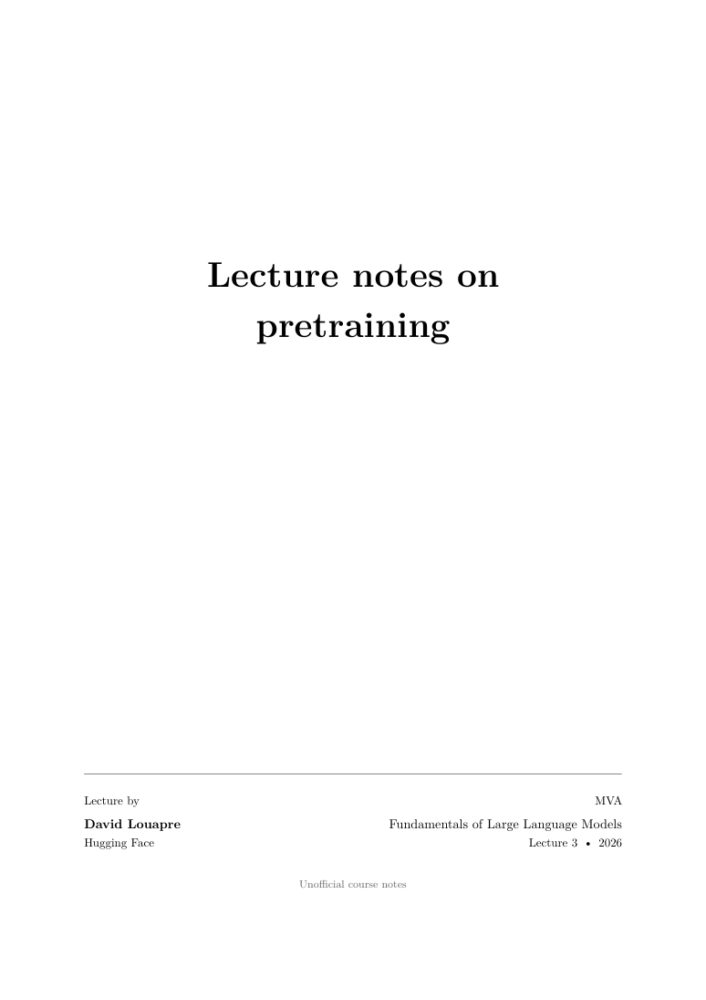

# Lecture notes on large language models

Lecture notes for the 2026 MVA course **Fundamentals of Large Language Models**, based on lectures by **David Louapre (Hugging Face)**.

The notes develop the course material through mathematical derivations, analysis of controlled experiments, original slide figures, and discussion of the research literature. The documents are written in English and typeset in LaTeX.

## Available notes

| Lecture | Topic | Document | Editable sources |
| --- | --- | --- | --- |
| 3 | Pretraining | [Read the PDF](notes/Lecture03_Pretraining_Notes.pdf) | [Browse LaTeX](lectures/03-pretraining/latex) · [Download source package](https://github.com/rivas-vega/LLMs_DLouap/raw/refs/heads/main/downloads/Lecture03_Pretraining_LaTeX_Source.zip) |

**[Download the pretraining notes](https://github.com/rivas-vega/LLMs_DLouap/raw/refs/heads/main/notes/Lecture03_Pretraining_Notes.pdf)**

## Lecture 3: Pretraining

A 75-page treatment of pretraining, with 67 figure crops from the course slides and 34 research and technical references. Controlled experiments with small chess models connect optimization choices to hyperparameter transfer and scaling predictions.

Topics include:

- Autoregressive modeling, the training objective, and transformer parameter counts.
- Compute and memory accounting, throughput, and model FLOPs utilization.
- AdamW, weight decay, optimizer timescales, and checkpointing.
- Learning-rate schedules, batch size, and training-horizon transfer.
- Width scaling, maximal update parameterization, and hyperparameter transfer.
- Compute-optimal scaling laws, inference cost, and experimental forecasts.
- Web-data extraction, filtering, deduplication, synthetic data, and data mixtures.
- Training stability, mixed precision, activation recomputation, and parallelism.

The appendices provide methodological clarifications, figure provenance, and a guide to the cited literature.

<a href="notes/Lecture03_Pretraining_Notes.pdf"></a>

## Repository structure

```text
notes/                          Compiled lecture notes
lectures/03-pretraining/latex/   LaTeX chapters, bibliography, and figures
downloads/                      Self-contained LaTeX source package
assets/                         Cover preview
```

## Build the notes

Install a current TeX Live or MiKTeX distribution with `latexmk`, pdfLaTeX, and BibTeX. From the repository root:

```sh
cd lectures/03-pretraining/latex
latexmk -pdf main.tex
```

The compiled document is `main.pdf` in that directory. All figures and bibliography files are included; compilation does not require external source files or network access.

Alternatively, compile manually:

```sh
pdflatex main.tex
bibtex main
pdflatex main.tex
pdflatex main.tex
```

For Overleaf, upload the [source ZIP](https://github.com/rivas-vega/LLMs_DLouap/raw/refs/heads/main/downloads/Lecture03_Pretraining_LaTeX_Source.zip), select `main.tex` as the main document, and use pdfLaTeX.

## Sources and attribution

These are independent, unofficial course notes. The course material and slide figures are attributed to David Louapre and the original research sources. Bibliographic details are included in the document and in [`references.bib`](lectures/03-pretraining/latex/references.bib); figure source pages and crop coordinates are listed in the [figure manifest](lectures/03-pretraining/latex/evidence/figure_manifest.json).

Additional derivations and explanations are study material. Reported experimental results come from the cited sources; the experiments have not been rerun for these notes. Context-dependent empirical findings are distinguished from general claims.

Corrections to mathematical statements, references, or typesetting are welcome through issues or pull requests.
